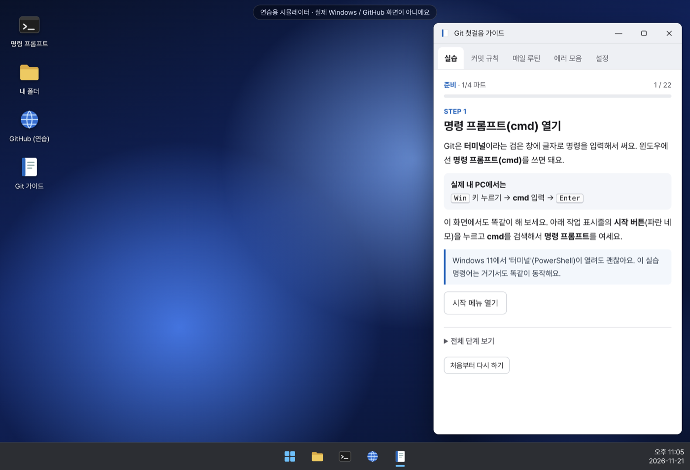
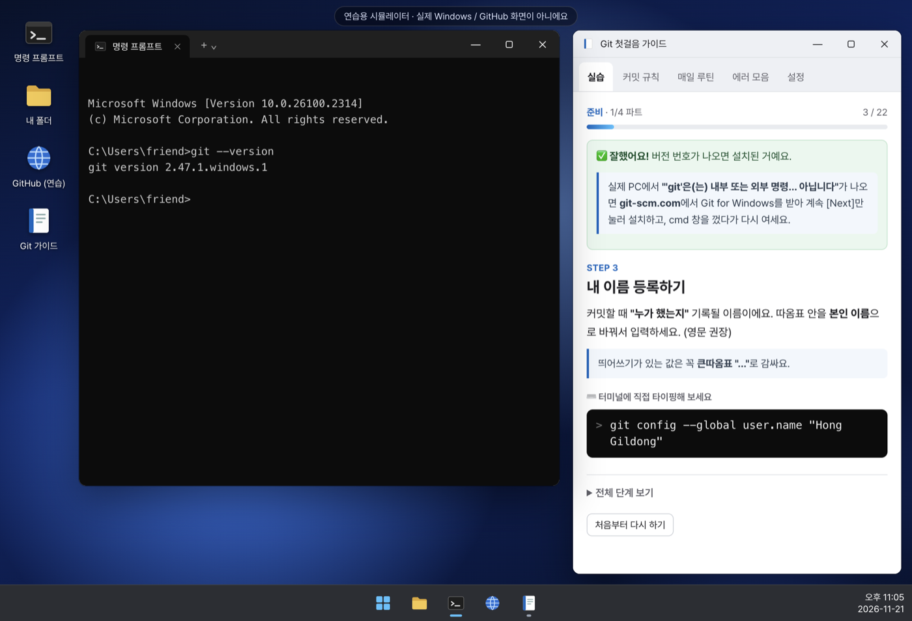
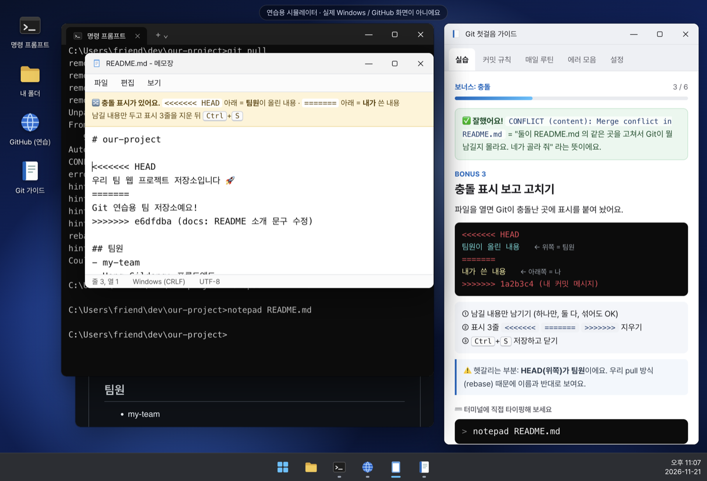

# Git 첫걸음 · 윈도우 cmd 실습

> Git이 처음인 사람을 위한 **브라우저 속 가상 윈도우 바탕화면 실습실**입니다.
> 설치도, 진짜 GitHub 계정도 필요 없어요. **[링크](https://yudamjung.github.io/git-guide-for-windows/)만 누르면 바로 시작!**



> ⚠️ 연습용 시뮬레이터예요. 실제 Windows / GitHub 화면이 아니에요.

## 이런 프로젝트예요

진짜 윈도우처럼 동작하는 바탕화면 위에서
**명령 프롬프트(cmd)**, **메모장**, **파일 탐색기**, **GitHub(연습)** 창을 직접 열고 만지면서
Git의 기본 흐름을 몸으로 익힙니다. 오른쪽 가이드 창이 한 단계씩 "지금 입력할 명령"을 알려줘요.

## 실제 작동 화면

### 1. 명령 프롬프트를 열고 명령어 입력하기

바탕화면 아이콘을 열거나 시작 메뉴에서 `cmd`를 검색해 터미널을 열어요.
가이드가 알려준 명령(`git --version` 등)을 입력하면 진짜 Git처럼 결과가 출력되고, 다음 단계로 넘어갑니다.



### 2. 내가 뭘 바꿨는지 확인하기 — `git status`

메모장으로 `README.md`를 고친 뒤 `git status`를 입력하면, 수정은 했지만 아직 담지 않은 파일이 빨간색으로 보여요.
단계마다 **"잘했어요!"** 피드백과 용어 설명이 붙습니다.


### 3. push가 거절당하는 상황도 연습

팀원이 먼저 push 하면 내 push는 거절돼요. 실제로 자주 만나는 상황을 일부러 겪어 보고
`git pull` → `git push`로 해결하는 방법을 배웁니다.


### 4. 22단계 완료!

clone · add · commit · push · pull 을 모두 해보면 앞으로 매일 쓸 루틴을 정리해 줘요.


### 5. 보너스: 충돌(conflict) 해결 연습

팀원과 같은 줄을 고쳐서 일부러 충돌을 만들고, `git pull` 때 나는 `CONFLICT` 메시지를 읽어요.


메모장에서 충돌 표시(`<<<<<<<`, `=======`, `>>>>>>>`)를 직접 지우고 저장한 뒤
`git add .` → `git rebase --continue` → `git push`로 마무리합니다.



## 실습 단계 (총 22단계 + 충돌 보너스 6단계)

| 파트 | 배우는 것 |
| --- | --- |
| **준비** | cmd 열기, `git --version`, `git config`(이름·이메일·pull 방식), GitHub 초대 수락 |
| **클론** | `mkdir`, `cd`, `dir`, `git clone` |
| **첫 커밋** | `git pull`, 메모장으로 파일 수정, `git status`, `git add .`, `git commit -m`, `git push`, `git log --oneline` |
| **실전** | 수정 → add → commit 반복, push 거절 → `git pull` → 다시 `git push` |
| **보너스: 충돌** | 같은 줄 수정, 충돌 해결, `git rebase --continue` |

가이드 창에는 **커밋 규칙 · 매일 루틴 · 에러 모음 · 설정** 탭도 있어요.
에러 모음에서는 `'git'은(는) 내부 또는 외부 명령...`, `fatal: not a git repository` 같은 흔한 오류의 원인과 해결법을 볼 수 있습니다.

## 특징

- **설치 없이 동작** — 의존성 없는 단일 `index.html` (HTML + CSS + JavaScript)
- **진짜 같은 윈도우 UI** — 창 드래그, 최소화/최대화, 작업 표시줄, 시작 메뉴 검색
- **오타·실수 안내** — 한/영 키 오류, 따옴표·`--amend` 실수 등을 감지해서 힌트를 줘요
- **내 레포 주소로 바꾸기** — 설정 탭에서 실제 레포 주소를 넣으면 실습 명령어가 그 주소로 바뀌어요
- **반응형** — 900px 이하에서는 가이드 → 터미널 세로 배치

## 사용 방법

설치나 다운로드 없이, 아래 링크만 누르면 바로 시작할 수 있어요.

👉 **[https://yudamjung.github.io/git-guide-for-windows/](https://yudamjung.github.io/git-guide-for-windows/)**

## 파일 구성

```
.
├── index.html        # 실습 화면 전체 (UI, 명령 해석기, 단계 정의)
├── docs/images/      # README용 스크린샷
└── README.md
```

## 참고

- 이 실습은 **가상 환경**이라 지원하는 명령은 가이드에 나오는 것들뿐이에요. 다른 `git` 명령은 "이 실습에선 다루지 않아요"라고 안내해 줍니다.
- 진행 상황은 브라우저에 저장돼요. 처음부터 다시 하려면 가이드 창의 **처음부터 다시 하기**를 누르세요.
