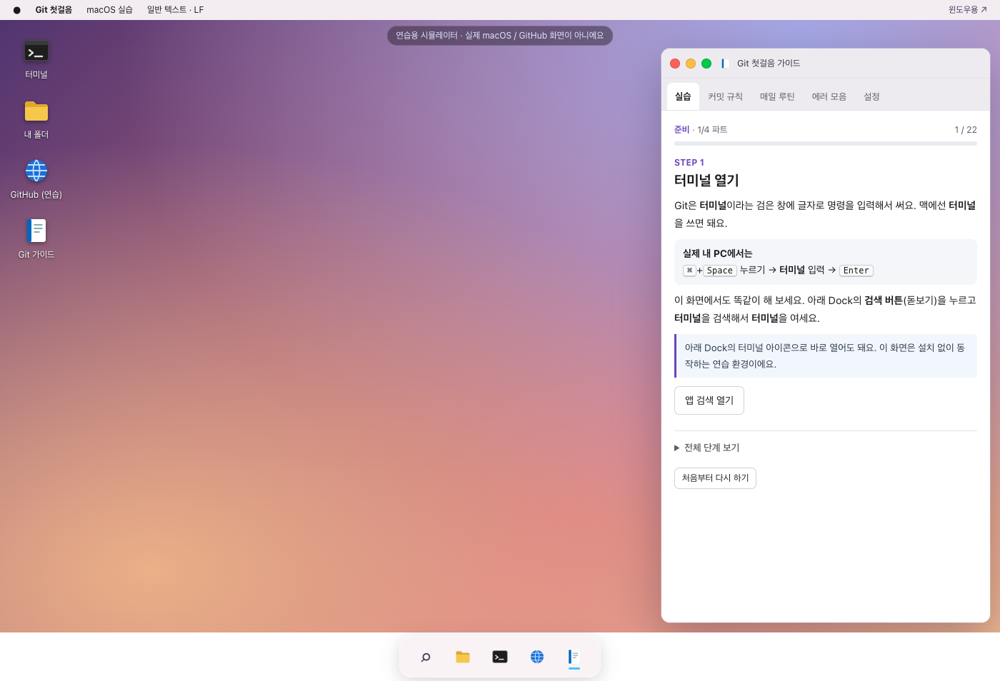
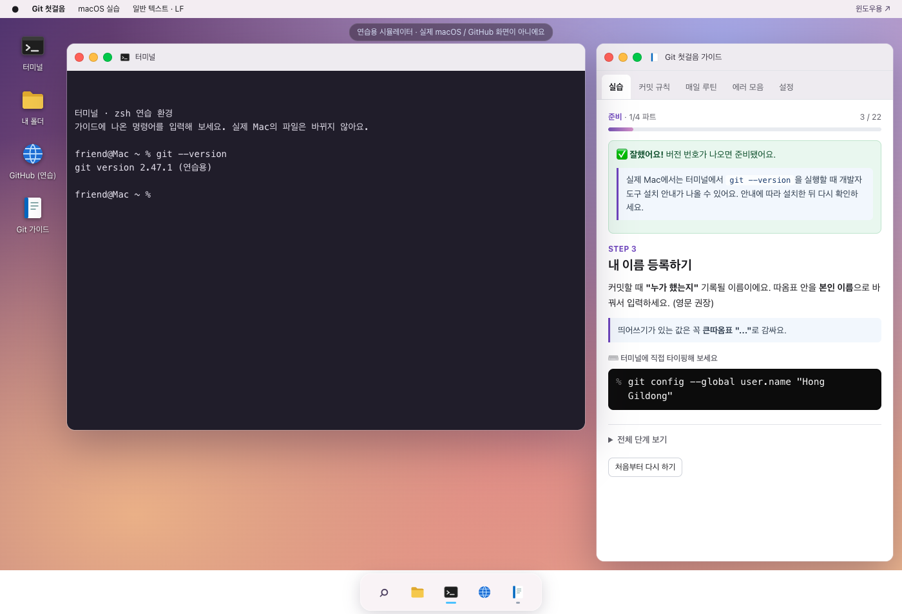
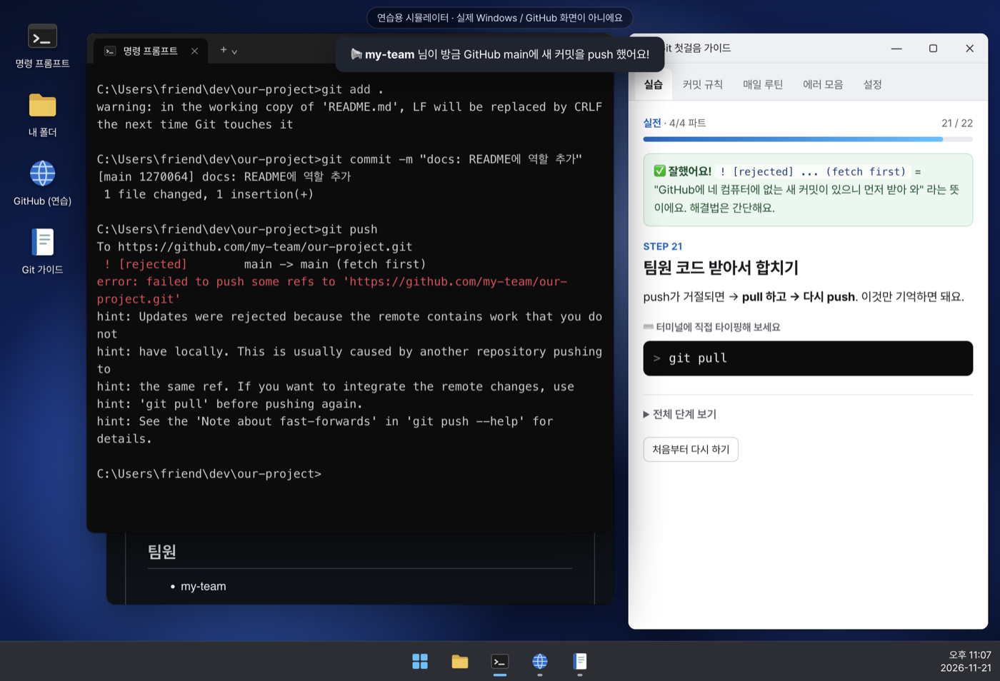
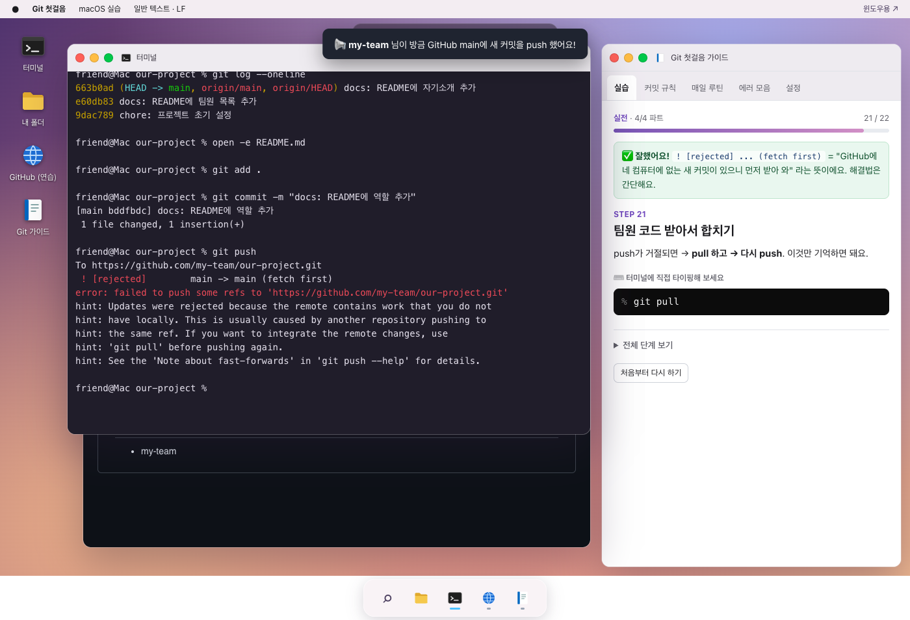
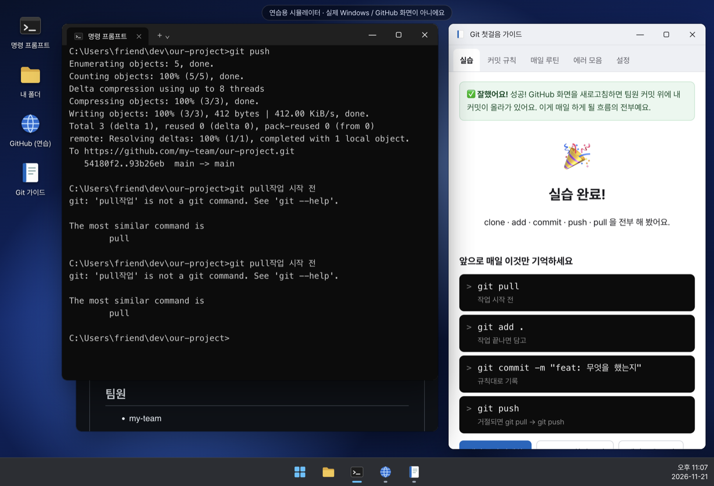
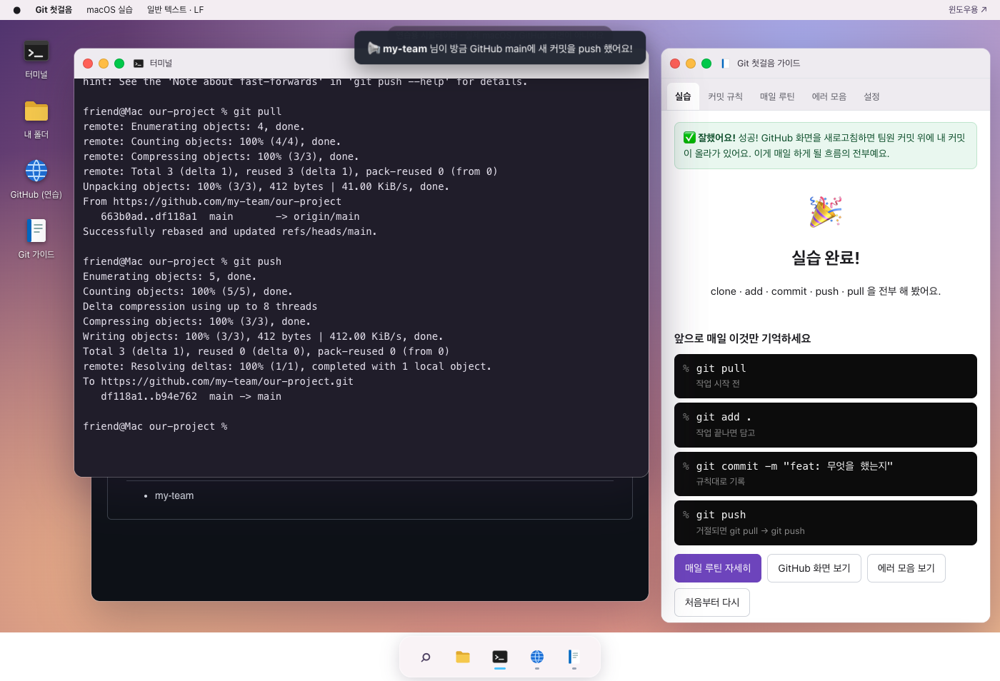
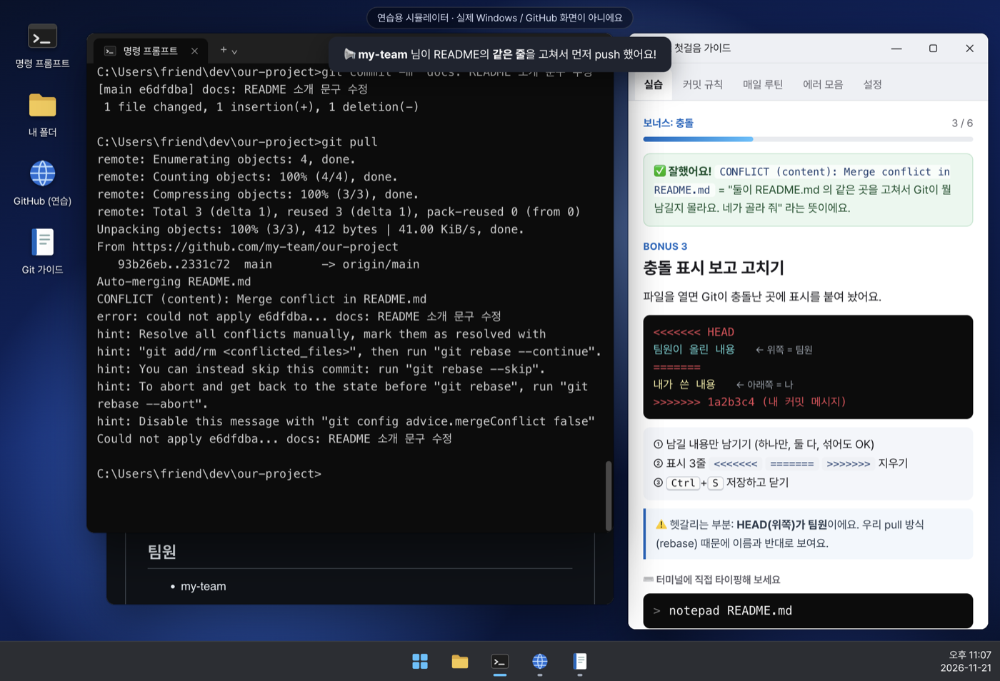
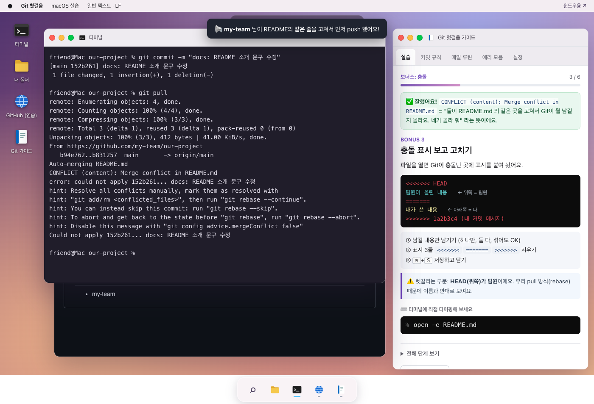
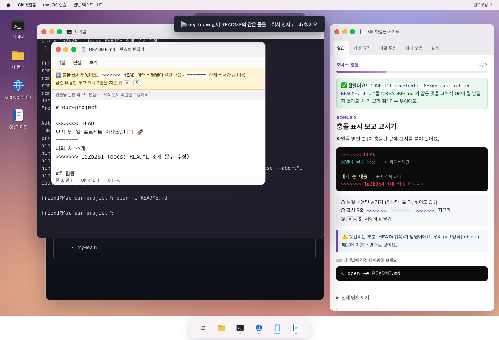

# Git 첫걸음 · 윈도우 cmd / 맥 터미널 실습

> Git이 처음인 사람을 위한 **브라우저 속 가상 바탕화면 실습실**입니다. **Windows**와 **macOS** 모두 지원해요.
> 설치도, 진짜 GitHub 계정도 필요 없어요. **내 운영체제 링크만 누르면 바로 시작!**

| 🪟 Windows (명령 프롬프트) | 🍎 macOS (터미널) |
| :---: | :---: |
| **[시작하기](https://yudamjung.github.io/git-guide-for-windows/)** | **[시작하기](https://yudamjung.github.io/git-guide-for-windows/mac/)** |
|  |  |

> ⚠️ 연습용 시뮬레이터예요. 실제 Windows / macOS / GitHub 화면이 아니에요.

## 이런 프로젝트예요

진짜 바탕화면처럼 동작하는 화면 위에서
**터미널(Windows는 cmd, Mac은 터미널)**, **메모장/텍스트 편집기**, **파일 탐색기/Finder**, **GitHub(연습)** 창을 직접 열고 만지면서
Git의 기본 흐름을 몸으로 익힙니다. 오른쪽 가이드 창이 한 단계씩 "지금 입력할 명령"을 알려줘요.

## 실제 작동 화면

왼쪽은 Windows, 오른쪽은 macOS예요. 단계와 흐름은 같고, 경로·프롬프트·편집기만 각 운영체제에 맞게 달라요.

### 1. 터미널을 열고 명령어 입력하기

Windows는 시작 메뉴에서 `cmd`, Mac은 Spotlight(`⌘`+`Space`)에서 `터미널`을 찾아 열어요. 가이드가 알려준 명령(`git --version` 등)을 입력하면 진짜 Git처럼 결과가 출력되고, 다음 단계로 넘어갑니다.

| 🪟 Windows | 🍎 macOS |
| :---: | :---: |
|  |  |

### 2. 내가 뭘 바꿨는지 확인하기 — `git status`

메모장(Mac은 텍스트 편집기)으로 `README.md`를 고친 뒤 `git status`를 입력하면, 수정은 했지만 아직 담지 않은 파일이 빨간색으로 보여요. 단계마다 **"잘했어요!"** 피드백과 용어 설명이 붙습니다.

| 🪟 Windows | 🍎 macOS |
| :---: | :---: |
|  |  |

### 3. push가 거절당하는 상황도 연습

팀원이 먼저 push 하면 내 push는 거절돼요. 실제로 자주 만나는 상황을 일부러 겪어 보고 `git pull` → `git push`로 해결하는 방법을 배웁니다.

| 🪟 Windows | 🍎 macOS |
| :---: | :---: |
|  |  |

### 4. 22단계 완료!

clone · add · commit · push · pull 을 모두 해보면 앞으로 매일 쓸 루틴을 정리해 줘요.

| 🪟 Windows | 🍎 macOS |
| :---: | :---: |
|  |  |

### 5. 보너스: 충돌(conflict) 해결 연습

팀원과 같은 줄을 고쳐서 일부러 충돌을 만들고, `git pull` 때 나는 `CONFLICT` 메시지를 읽어요.

| 🪟 Windows | 🍎 macOS |
| :---: | :---: |
|  |  |

### 6. 충돌 표시 지우고 마무리

편집기에서 충돌 표시(`<<<<<<<`, `=======`, `>>>>>>>`)를 직접 지우고 저장한 뒤 `git add .` → `git rebase --continue` → `git push`로 마무리합니다. (저장은 Windows `Ctrl`+`S`, Mac `⌘`+`S`)

| 🪟 Windows | 🍎 macOS |
| :---: | :---: |
|  |  |

## 실습 단계 (총 22단계 + 충돌 보너스 6단계)

| 파트 | 배우는 것 |
| --- | --- |
| **준비** | cmd 열기, `git --version`, `git config`(이름·이메일·pull 방식), GitHub 초대 수락 |
| **클론** | `mkdir`, `cd`, `dir`, `git clone` |
| **첫 커밋** | `git pull`, 메모장으로 파일 수정, `git status`, `git add .`, `git commit -m`, `git push`, `git log --oneline` |
| **실전** | 수정 → add → commit 반복, push 거절 → `git pull` → 다시 `git push` |
| **보너스: 충돌** | 같은 줄 수정, 충돌 해결, `git rebase --continue` |

가이드 창에는 **커밋 규칙 · 매일 루틴 · 에러 모음 · 설정** 탭도 있어요.
에러 모음에서는 `'git'은(는) 내부 또는 외부 명령...`, `fatal: not a git repository` 같은 흔한 오류의 원인과 해결법을 볼 수 있습니다.

## 특징

- **설치 없이 동작** — 의존성 없는 단일 HTML 파일 (Windows `index.html`, macOS `mac/index.html`)
- **진짜 같은 데스크톱 UI** — 창 드래그, 최소화/최대화, 작업 표시줄(Windows)·Dock(Mac), 앱 검색
- **오타·실수 안내** — 한/영 키 오류, 따옴표·`--amend` 실수 등을 감지해서 힌트를 줘요
- **내 레포 주소로 바꾸기** — 설정 탭에서 실제 레포 주소를 넣으면 실습 명령어가 그 주소로 바뀌어요
- **반응형** — 900px 이하에서는 가이드 → 터미널 세로 배치

## Windows vs macOS

| | 🪟 Windows | 🍎 macOS |
| --- | --- | --- |
| 터미널 | 명령 프롬프트(cmd) | 터미널(zsh 스타일 프롬프트) |
| 폴더 보기 | `dir`, `cd`, 파일 탐색기 | `ls`, `pwd`, `cd`, Finder (`open .`) |
| 파일 수정 | 메모장 (`notepad`) | 텍스트 편집기 (`open -e README.md`) |
| 저장 | `Ctrl`+`S` | `⌘`+`S` |
| 진행 상황 | 브라우저에 따로 저장 | 브라우저에 따로 저장 (Windows와 섞이지 않아요) |

둘 다 같은 Git 흐름(clone → 수정 → add → commit → push, push 거절, 충돌 보너스)을 연습하는 브라우저 시뮬레이터예요. 실제 OS 앱이나 전체 셸 기능을 구현하지는 않습니다.

## 사용 방법

설치나 다운로드 없이, 내 운영체제에 맞는 링크만 누르면 바로 시작할 수 있어요.

- 🪟 **Windows** 👉 [https://yudamjung.github.io/git-guide-for-windows/](https://yudamjung.github.io/git-guide-for-windows/)
- 🍎 **macOS** 👉 [https://yudamjung.github.io/git-guide-for-windows/mac/](https://yudamjung.github.io/git-guide-for-windows/mac/)

## 파일 구성

```
.
├── index.html        # Windows용 실습 화면 전체 (UI, 명령 해석기, 단계 정의)
├── mac/index.html    # macOS용 단일 파일 실습
├── tests/            # macOS 실습 스모크 테스트
├── docs/images/      # README용 스크린샷 (Windows)
│   └── mac/          # README용 스크린샷 (macOS)
└── README.md
```

## 참고

- 이 실습은 **가상 환경**이라 지원하는 명령은 가이드에 나오는 것들뿐이에요. 다른 `git` 명령은 "이 실습에선 다루지 않아요"라고 안내해 줍니다.
- 진행 상황은 브라우저에 저장돼요. 처음부터 다시 하려면 가이드 창의 **처음부터 다시 하기**를 누르세요.
